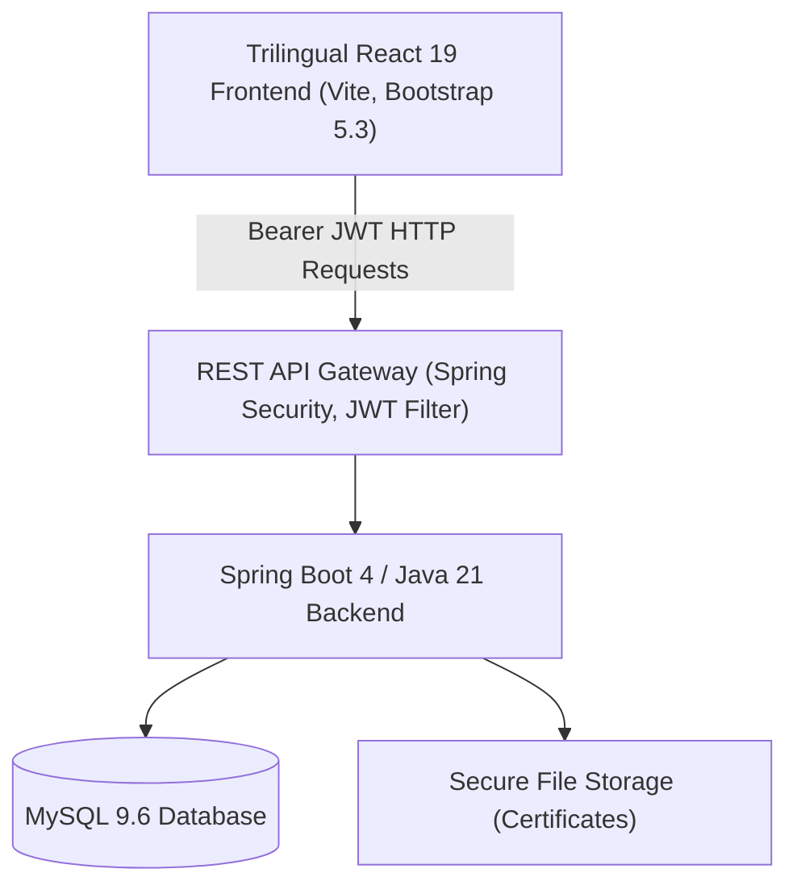

# 🩸 Blood Bank Management System (LifeFlow / Blood Connect)

A production-grade, full-stack Blood Bank Management and Distribution System designed for centralized blood inventory tracking, donor verification, automated requests, and official hospital dispatching.

---

## 🌟 Key Highlights & Features

- 🔐 **Role-Based Access Control (RBAC)**: Secure stateless JWT authentication with three role tiers (`USER`, `ADMIN`, `SUPER_ADMIN`).
- 🌐 **Trilingual Interface**: Native support for **English**, **Telugu (తెలుగు)**, and **Hindi (हिंदी)** with instant language toggling and onboarding selection.
- 📋 **Donor Management & Verification**: Digital medical fitness certificates, MIME & size validation, and multi-state verification workflows (`PENDING`, `VERIFIED`, `REJECTED`, `RESUBMISSION_REQUIRED`).
- 📦 **Automated Inventory & Allocation**: Real-time stock counts across all 8 blood groups (A+, A-, B+, B-, AB+, AB-, O+, O-) with automatic reserve deduction and cancellation restoration.
- 🚚 **Hospital Blood Issue & Official Dispatch**: Full audit trail for patient delivery, unique tracking sequence (`ISS-YYYY-XXXXX`), recipient verification, and printable official hospital dispatch slips.
- 🛡️ **Defensive Security**: Password hashing with BCrypt, HTTP status isolation (401 vs 403), sanitized error messages, and CORS configured for cloud environments.

---

## 🏗️ Architecture & Technology Stack



### Backend
- **Framework**: Spring Boot 4.1.0 / Spring Framework 7
- **Language**: Java 21 LTS
- **Security**: Spring Security 7 + JJWT 0.12.6
- **Database ORM**: Hibernate 7.4 / Spring Data JPA
- **Database Engine**: MySQL 9.6
- **Build Tool**: Apache Maven (`mvnw.cmd` wrapper)

### Frontend
- **Framework**: React 19
- **Build Tool**: Vite 8
- **Styling**: Bootstrap 5.3 + Custom CSS
- **Routing**: React Router v7
- **HTTP Client**: Axios with global JWT request & 401 response interceptors

---

## 🚀 Getting Started

### 1. Prerequisites
- **Java**: JDK 21 LTS (`java -version`)
- **Node.js**: v18+ and npm (`node -v`, `npm -v`)
- **MySQL**: MySQL 8.x or 9.x running on port `3306`

### 2. Database Setup
```sql
CREATE DATABASE bloodbank;
```

### 3. Backend Configuration & Startup
```powershell
# Navigate to the backend directory
cd blood-bank-management

# Run with Maven Wrapper
.\mvnw.cmd spring-boot:run
```
*The backend starts at `http://localhost:8082` and automatically initializes the Super Admin account.*

### 4. Frontend Startup
```powershell
# Navigate to the frontend directory
cd blood-bank-frontend

# Install dependencies (first time only)
npm install

# Start Vite development server
npm run dev
```
*The frontend opens at `http://localhost:5173`.*

---

## 🔑 Default Credentials

| Role | Email | Password | Access Scope |
| :--- | :--- | :--- | :--- |
| **Super Admin** | `superadmin@bloodbank.org` | `SuperAdmin@2026!` | Full System Control, User Role Management, Audits |
| **Admin** | `admin@bloodbank.org` | `Admin@123` | Approvals, Dispatches, Inventory, Verification |
| **User / Donor** | `john@example.com` | `Password@123` | Request Blood, Register as Donor, Upload Certificates |

---

## 🌐 Cloud Deployment Guide

### Frontend (Vercel / Netlify)
1. **Vercel**:
   - Push repository to GitHub.
   - Import project in Vercel.
   - Set **Root Directory** to `blood-bank-frontend`.
   - Set Environment Variable:
     `VITE_API_BASE_URL` = `https://your-backend-service.onrender.com`
   - Deploy! (`vercel.json` rewrite rule is pre-configured).

2. **Netlify**:
   - Set **Base directory**: `blood-bank-frontend`
   - Set **Build command**: `npm run build`
   - Set **Publish directory**: `blood-bank-frontend/dist`
   - Deploy! (`public/_redirects` is pre-configured).

### Backend (Render / Railway / Docker)
1. **Docker Container**:
   ```bash
   cd blood-bank-management
   docker build -t blood-bank-backend .
   docker run -p 8082:8082 -e SPRING_DATASOURCE_URL=jdbc:mysql://host:3306/bloodbank -e SPRING_DATASOURCE_USERNAME=root -e SPRING_DATASOURCE_PASSWORD=secret blood-bank-backend
   ```
2. **Environment Variables for Cloud**:
   - `PORT`: Provided automatically by host (default `8082`)
   - `SPRING_DATASOURCE_URL`: Managed MySQL JDBC URL (e.g., Aiven, Railway MySQL, PlanetScale)
   - `SPRING_DATASOURCE_USERNAME`: Cloud database username
   - `SPRING_DATASOURCE_PASSWORD`: Cloud database password
   - `JWT_SECRET`: 256-bit secure key

---

## 📄 License & Academic Attribution
Developed as a Final Year Computer Science and Engineering Capstone Project.
Designed and implemented by **C. Usharani** (2026).
